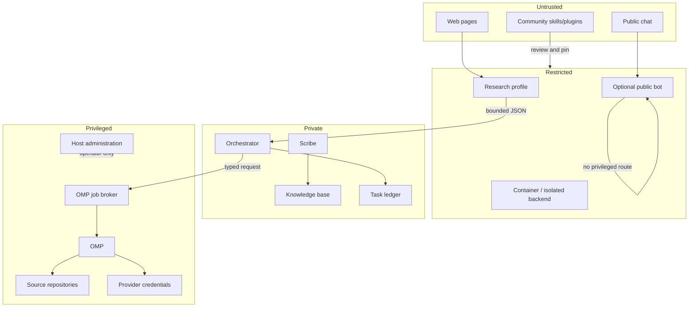

# Architecture

## The split

Hermes and OMP solve different operating problems, but OMP is optional. Hermes codes through its terminal and tool surfaces. Add OMP when software engineering is a large enough share of the work to justify a dedicated harness with integrated repository, LSP, debugger, browser, structured-editing, session, and delegation workflows — the difference is the tooling around the work, not whether Hermes can do it.

| Concern | Hermes | OMP |
|---|---|---|
| Always-on chat and gateway | Primary owner | Not the intended role |
| Scheduled work | Native cron and no-agent jobs | Called only for bounded engineering jobs |
| Multiple long-lived identities | Native profiles | Per-project sessions and typed subagents |
| Durable task ledger | Hermes kanban | Consumes explicit jobs |
| Interactive software engineering | Native coding tools can own the selected scope | Optional dedicated owner when the workload needs OMP's integrated engineering workflow |
| LSP, debugger, browser, structural edits | Some capabilities exist or can be added | Integrated first-class tools |
| Provider credentials for coding subscriptions | Should not be exposed to optional public-facing profiles | Stored locally or behind OMP auth broker/gateway |
| Public or community chat | Capability-restricted profile | Never exposed directly |

When OMP is enabled, keep the boundary intentional. Do not turn OMP into an optional public bot, and do not give an optional public Hermes profile the credentials and filesystem access used by the coding harness.

## Logical components

### Control plane

- **Operator surface:** private Discord, Telegram, Slack, CLI, or Hermes dashboard.
- **Orchestrator profile:** receives requests, decides ownership, updates the task ledger, and calls narrow integrations.
- **Human approvals:** required for destructive commands, credential changes, service restarts, publication, and spending-policy changes.
- **Improvement loop:** guards, evals, audits, and compatibility checks produce evidence-backed proposals for an explicit operator review surface, such as a private inbox or standup channel. The proposing profile cannot approve, install, restart, or publish its own recommendation.
- **External monitor:** checks that the Hermes gateway and backup jobs still run. It must not depend on Hermes being healthy.

### Work plane

- **Scribe module:** optional sole routine writer of a shared knowledge base.
- **Research quarantine module:** optional search/extract profile with no shell or privileged file access.
- **Engineer module:** optional Hermes-native coding tools or, when the workload benefits from a dedicated engineering harness, OMP interactive sessions and bounded jobs from Hermes.
- **Auditor module:** optional read-only evidence gathering and review.
- **Public bot module:** optional smallest tool surface with separate memory and credentials.

These roles describe one workload-specific reference deployment, not a universal roster.
Select only modules with named consumers and acceptance scenarios.

### Data plane

Keep these stores distinct:

| Store | Purpose | Writer policy |
|---|---|---|
| Hermes profile home | Config, credentials, sessions, skills, memory, cron | One profile/process owns each home. |
| Git-backed Markdown knowledge base | Decisions, runbooks, durable facts | One routine writer; human edits are reconciled. |
| Hermes kanban | Work state, ownership, dependencies | Orchestrator plus explicit workers. |
| Coding repositories | Source and tests | One active writer per shared checkout; use worktrees for parallel jobs. |
| OMP session/auth state | Coding sessions and provider credentials | Operator-owned OMP process or OMP auth broker. |
| Backup repository | Recovery data | Backup service only; restore is operator-gated. |

Session-store ownership depends on the installed gateway version and topology. A multiplexed
process does not prove that every profile writes the serving profile's database. Identify the
store from a live session identifier and a known control message, checking both the serving
profile and the named profile when necessary. A secondary store can also contain standalone
command-line sessions. Never infer completeness from an empty query, an existing database or
the process-wide home directory. Keep profile, speaker and audience authorization separate
from the storage location.

A wiki edit must never silently become a privileged task. A task body must never be injected into every coding session. List metadata first; open untrusted bodies explicitly.

## Gateway topology

Select topology against the installed release, not a remembered configuration key.
The bundled gateway guide inspected on 2026-09-23 defaults to multiplexing after preflight,
retires `gateway.multiplex_profiles: false` and `gateway.multiplex_profile_allowlist`,
and serves every live named profile when multiplexing is active.

### Separate processes or deployment roots

Separate processes can provide independent restart and crash domains, but the inspected
release requires an explicit standalone override for a separate per-profile gateway.
Follow its installed command help and migration procedure; do not assume the old default.

Use it when:

- profiles need independent restarts;
- an optional public bot should not share a process with private agents;
- debugging and failure attribution matter more than process count;
- different bot tokens and services are acceptable.

This is process isolation, not OS-user or filesystem isolation. Profiles using the same account and local terminal backend can still reach that account's files unless another boundary prevents it.

### Multiplexed gateway — density optimization

An explicit `gateway.multiplex_profiles: true` selects multiplexing without the unset-key preflight. It serves every live named profile, not a configurable subset. The retired allowlist is not containment; inventory the served profiles, platforms and scheduled work before changing topology. Archiving or deleting a profile requires separate operator authorization.

Use it when:

- many low-traffic internal profiles make multiple services operationally expensive;
- one restart domain is acceptable;
- shared gateway infrastructure is desirable;
- you have tested every profile's resolved plugin, platform, skill, model, and credential state under multiplexing.

Costs:

- one process is a common crash and restart domain;
- plugin registration and adapter behavior need multiplex-specific verification;
- HTTP-inbound profiles share the listener and use `/p/<profile>/` routing;
- secondary profiles must not bind their own HTTP ports;
- each polling platform still needs a distinct token per profile unless explicit profile routes share a bot.

If a public companion requires a separate process or operating-system boundary, plan a
separate deployment deliberately. A profile name alone provides neither boundary.

Official references: [Profiles](https://hermes-agent.nousresearch.com/docs/user-guide/profiles/) and [Running Many Gateways](https://hermes-agent.nousresearch.com/docs/user-guide/multi-profile-gateways).

Version source: bundled `website/docs/user-guide/multi-profile-gateways.md`, inspected
2026-09-23, sections on default preflight, standalone override and served-profile enumeration.

## Trust boundaries

No text classifier turns untrusted content into trusted instructions. The restricted profile's absent capabilities are the primary control; validation and injection scanning are additional controls.

## Integration contracts

Every enabled cross-boundary interface should be narrower than free-form chat:

- **Research result:** JSON object with answer, source URLs, retrieval time, and explicit size limits.
- **Coding job/result:** use the separate [hermes-omp-broker](https://github.com/ghosty-11/hermes-omp-broker) specification and schema.
- **Mailbox message:** use [hermes-mailbox](https://github.com/ghosty-11/hermes-mailbox); messages carry information, not authority.
- **Knowledge handoff:** source, date, confidence/provenance, canonical topic; never raw page text promoted automatically.
- **Operator notification:** named destination and severity; silence on healthy routine checks.

## Loops in the system

The planes describe what exists. The loops describe what repeats. Four loops wrap each other, and every mechanism this guide covers sits in one of them.

| Loop | What repeats | Where this guide covers it |
|---|---|---|
| Agent | A profile calls tools until one request is complete. | [Profiles and models](profiles-and-models.md) |
| Verification | A check scores the result and returns failures. | [Verification](verification.md), guard checks and evals |
| Event-driven | A schedule or webhook starts work with no operator present. | [Scheduled jobs](scheduled-jobs.md) |
| Improvement | Evidence from real runs changes the configuration. | [Verification](verification.md), operator-gated improvement loop |

Two properties matter more than the ordering.

**The check is the load-bearing part of the verification loop.** Generation is cheap and unbounded, so the check is what converts activity into a result you can rely on. A deterministic check beats a model judgment wherever the requirement has a right answer, which is why this guide separates guards from evals instead of treating both as testing.

**The improvement loop reaches inside the others.** Its output is not a report. It is a change to an instruction, a tool description, a threshold, or a rubric that the loops below then use. Because that is a self-modification path, keep it operator-gated: the proposer holds evidence and a recommendation, never the authority to apply, deploy, restart, or spend.

A loop that no component owns does not run. Name the owner of each enabled loop in the deployment checklist, and record an unowned improvement loop as an accepted gap rather than leaving it as an implied capability.

## Failure model

Design for these failures explicitly:

| Failure | Expected behavior |
|---|---|
| Primary provider returns 429/5xx | Try a different provider, then optional local degraded lane. |
| Search or extractor is down | Research fails with a clear dependency status; no fabricated current answer. |
| Quarantine output is malformed | Drop it. Do not forward partial prose. |
| OMP broker is unavailable | Hermes keeps chat/board operation; coding job remains queued or fails visibly. |
| Gateway crashes | Supervisor restarts it; external dead-man alert fires if it stays down. |
| Cron dependency missing | Preflight blocks before model spend. |
| Backup succeeds but restore is broken | Restore drill fails; backup is not considered healthy. |
| Plugin update changes a wrapped upstream seam | Compatibility test fails before deployment. |
| Optional public prompt tries to invoke privileged work | Optional public profile has no route or tool to perform it. |

## Optional modules and remaining custom work

Released optional packages and deployment-specific work serve different purposes.
Select only modules needed by named use cases; package availability is not proof that a
deployment has enabled or verified them:

1. [hermes-web-research](https://github.com/ghosty-11/hermes-web-research) for a fail-closed web-research hop between capability-separated profiles;
2. [hermes-omp-broker](https://github.com/ghosty-11/hermes-omp-broker) for typed Hermes-to-OMP coding delegation;
3. [hermes-mailbox](https://github.com/ghosty-11/hermes-mailbox) for listing-first cross-harness messages when the task ledger alone is insufficient;
4. policy checks that compare profile charters to resolved tool schemas;
5. a local-model-aware context/compaction policy when cloud and local windows differ materially;
6. an optional ambient public-chat adapter—such as [ghosty-11/hermes-discord-ambient](https://github.com/ghosty-11/hermes-discord-ambient)—if an enabled public bot should sometimes join a conversation.

Each selected custom piece needs a narrow contract, fail-closed behavior, upstream seam reference, and end-to-end test.
